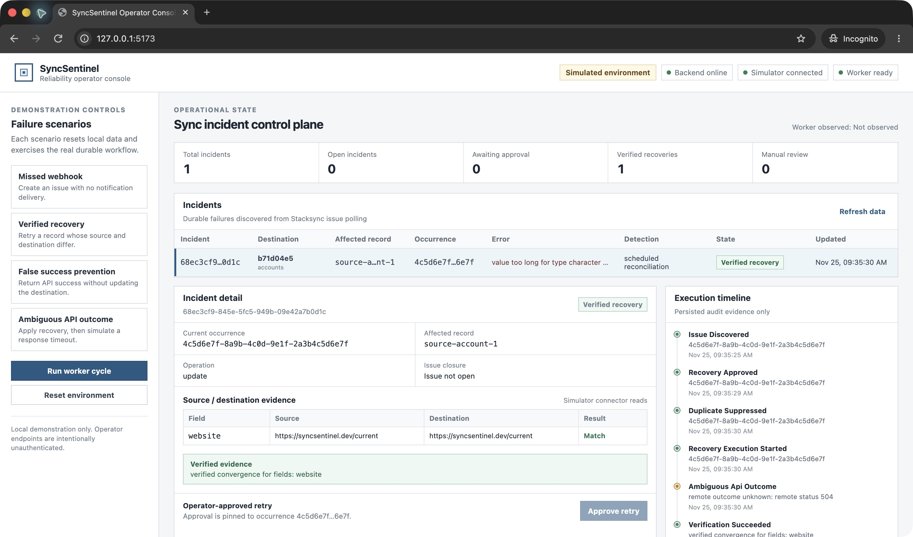
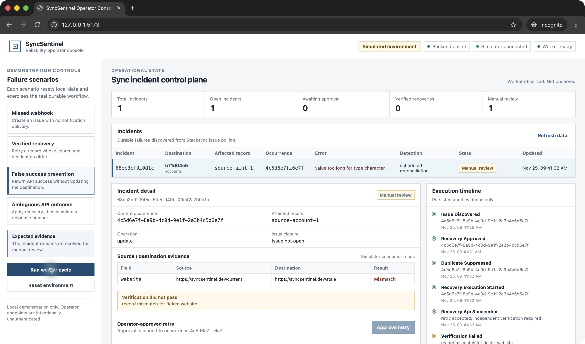

# SyncSentinel

SyncSentinel is an independent reliability engineering demonstration built around Stacksync's documented sync-issue APIs. It shows how durable reconciliation, occurrence-specific operator approval, leased recovery, and independent verification can prevent a successful API response from being mistaken for successful data repair.

This project is not affiliated with Stacksync, is not a commercial service, and does not claim production readiness or exactly-once external execution. It uses only simulated records and local infrastructure.

## Why this is relevant to Stacksync

Two-way synchronization turns ordinary API uncertainty into a distributed-systems problem: notifications can be missed, retries can have unknown outcomes, and API acceptance does not prove connector convergence. SyncSentinel makes those failure boundaries visible in a small, reviewable control loop while respecting Stacksync's existing issue-retry capabilities instead of duplicating the sync engine.

## What the demonstration proves

- Webhook notifications are persisted as reconciliation hints, while scheduled polling remains the correctness path.
- Stable incident identity is distinct from a changing Stacksync issue occurrence ID.
- SQLite transactions co-locate state changes, durable jobs, and structured audit events.
- Recovery requires occurrence-specific operator approval and fenced work leases.
- A retry response never resolves an incident by itself.
- Resolution requires a non-empty field comparison, observed source/destination convergence, confirmation that the relevant issue is no longer open, and confirmation that the occurrence is still current.
- Ambiguous external outcomes move to verification and are not blindly retried.
- Expired leases are recovered during normal worker ticks, not only at process startup.

## Dashboard





## Documented webhook limitations

Stacksync's official [sync webhook documentation](https://docs.stacksync.com/two-way-sync/features/sync-webhooks) makes scheduled reconciliation necessary:

- A notification is a failed-batch signal, not an authoritative issue event; it contains no issue ID or affected-record count.
- Delivery is best effort with one delivery attempt. Stacksync does not retry failed delivery, inspect the receiver response, retain notification history, or provide replay.
- Calls may be concurrent, bursty, repeated, and out of order. `created_time` is not an ordering guarantee.
- An issue can become visible after its notification, some issues produce no notification, and resolution produces no notification.
- Notifications use bearer authorization but are not cryptographically signed.

SyncSentinel therefore persists webhook hints before acknowledgement, coalesces bursts, and treats scheduled issue polling as the correctness path. “One delivery attempt” must not be confused with exactly-once processing.

## Architecture

```text
React operator console
        │
        v
FastAPI control plane ───────────────> SQLite
        │                        incidents, jobs,
        │                        leases, audit log
        v
simulated Stacksync HTTP API
 issues + source/destination records

webhook hint ─┐
scheduled poll ├─> reconciliation ─> incident ─> approval ─> retry
lease recovery ┘                                      │
                                                      v
                                     independent record + issue verification
```

The React console is an operator view over real backend state. Its scenario controls call local-only simulator endpoints so each failure mode is reproducible.

## Prerequisites and installation

- Python 3.12+
- [`uv`](https://docs.astral.sh/uv/)
- Node.js 20+
- [`pnpm`](https://pnpm.io/) 9+

```bash
uv sync --extra dev
pnpm --dir frontend install
```

## Run the complete local demonstration

Use three terminals from the repository root. Bind all services to loopback; the operator and simulator controls intentionally have no user authentication.

Terminal 1 — simulated Stacksync API:

```bash
uv run uvicorn 'syncsentinel.simulator:create_demo_simulator' \
  --factory --host 127.0.0.1 --port 8001
```

Terminal 2 — SyncSentinel API and deterministic worker controls:

```bash
SYNCSENTINEL_DB=./syncsentinel-demo.sqlite3 \
STACKSYNC_WEBHOOK_SECRET=demo-secret \
STACKSYNC_BASE_URL=http://127.0.0.1:8001 \
uv run uvicorn 'syncsentinel.demo:create_demo_application' \
  --factory --host 127.0.0.1 --port 8000
```

Terminal 3 — operator console:

```bash
pnpm --dir frontend dev --host 127.0.0.1
```

Open <http://127.0.0.1:5173>. Choose a scenario, inspect the discovered incident and audit evidence, approve retry when available, and select **Run worker cycle**. **Reset environment** clears demonstration state but retains the configured polling target.

### Demonstration scenarios

1. **Missed webhook** creates no notification. Scheduled reconciliation still discovers the issue.
2. **Verified recovery** accepts an approved retry, converges the records, closes the issue, and resolves only after independent observation.
3. **False success prevention** returns success and closes the issue without changing the destination. Field mismatch routes the incident to manual review.
4. **Ambiguous API outcome** applies the retry and returns HTTP 504. SyncSentinel records ambiguity, verifies closure and convergence, and does not repeat execution.

## Verification commands

```bash
uv run pytest -q
pnpm --dir frontend typecheck
pnpm --dir frontend lint
pnpm --dir frontend test
pnpm --dir frontend build
```

At this handoff the backend suite reports 38 passed tests. The frontend suite reports 2 passed component tests; type checking, linting, and the production build also pass.

## Documented behavior versus simulation

The verified public behavior and citations are recorded in [docs/RESEARCH.md](docs/RESEARCH.md). The issue-list and resolution routes, payload shapes, optional issue fields, pagination token behavior, and webhook notification shape follow that research.

The following are explicitly simulation-only:

- source and destination record-read routes;
- mapping both record sides through destination app/table identifiers;
- scenario loading, reset, and deterministic worker-tick endpoints;
- the shared bearer secret used for local webhook ingestion;
- controllable convergence, rejection, missing-record, and timeout-after-apply behavior.

The researched documentation does not establish a universal Stacksync record-verification endpoint, webhook signature scheme, external idempotency key, or atomic snapshot spanning issue state and connector records.

## Important correctness limits

- Record values, issue closure, and the SQLite transition are separate observations, not an atomic cross-system transaction. A later poll can reopen an incident observed open again.
- HTTP timeouts cannot prove whether an external action ran. Verification reduces unsafe retries but cannot create exactly-once semantics.
- The simulator's field and record mapping is a deterministic demonstration convention, not a universal connector contract.
- SQLite is appropriate for this single-host demonstration and intentionally limits horizontal concurrency.
- Operator, demo-control, and read endpoints are unauthenticated. They must remain local and are unsuitable for real customer data.
- Verification is bounded and fails closed to manual review for empty comparison fields, missing records, malformed responses, stale occurrences, mismatches, or an issue still observed open.
- The in-memory simulator loses record state on restart; SyncSentinel's incident, work, and audit state remains durable in SQLite.

## Repository map

- `src/syncsentinel/` — domain model, persistence, gateways, workers, API, and simulator
- `frontend/` — React/TypeScript operator console
- `tests/` — foundational, acceptance, HTTP gateway, and review-regression tests
- `docs/RESEARCH.md` — verified facts, assumptions, and simulation boundaries
- `docs/ARCHITECTURE.md` — state, transaction, fencing, and verification design
- `docs/IMPLEMENTATION_PLAN.md` — scoped delivery plan

No frontend expansion, authentication system, multi-tenancy, paid service, or external infrastructure is included.
